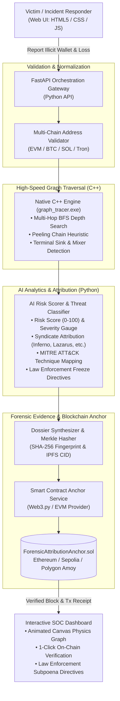

# ⚡ ChainForensix AI: Automated Multi-Hop Crypto Forensic Pipeline & Blockchain Anchor

[](https://github.com)
[](LICENSE)
[](engine/)
[](pipeline/)
[](contracts/)
[](Dockerfile)

> **Hackathon Problem Statement:**  
> *"How to build an automated AI-driven analytics pipeline that ingests victim-reported illicit cryptocurrency wallet addresses, traces multi-hop transactions across decentralized networks, and anchors forensic evidence onto an immutable blockchain smart contract to assist rapid cyber-incident attribution."*

---

## 🌟 Executive Summary & Pitch

In modern cyber incidents involving crypto assets (e.g., Permit2 phishing drainers, ransomware extortion cartels, bridge exploits), victims lose funds within seconds. The attacker immediately routes funds across **multi-hop peeling chains**, anonymity mixers (e.g., Tornado Cash, Sinbad), and decentralized bridges before off-ramping into centralized exchanges (CEX).

**ChainForensix AI** solves this with an end-to-end automated pipeline:
1. **Victim Ingestion System:** Real-time ingestion of victim-reported illicit addresses across EVM, Bitcoin, Solana, and Tron with checksum validation.
2. **Native C++ Multi-Hop Traversal Engine:** A high-throughput C++ graph traversal core that traces transaction graphs across $N$-hop depths in milliseconds, detecting peeling chains, mixer funneling, and terminal sinks.
3. **AI Risk Scorer & Threat Attribution:** Behavioral heuristics and machine learning that calculate risk scores (0–100), classify threat syndicates (e.g., *Inferno Drainer*, *Pink Drainer*, *Lazarus Group*, *LockBit*), and map MITRE ATT&CK techniques.
4. **Immutable Smart Contract Anchor:** Computes a deterministic SHA-256 / Merkle fingerprint of the forensic dossier and anchors it to an EVM smart contract (`ForensicAttributionAnchor.sol`), providing court-admissible, tamper-proof proof of attribution.
5. **Interactive SOC Dashboard:** Modern dark cyber-forensics interface built with HTML5, Glassmorphic CSS, and animated HTML5 Canvas force-directed graph rendering.

---

## 📐 System Architecture



---

## 💻 Tech Stack Breakdown

| Layer | Technology | Role in Project |
|---|---|---|
| **Frontend** | HTML5, Modern CSS (Glassmorphism), Vanilla JS, Canvas API | Cyber-Forensics SOC dashboard, real-time animated graph rendering, 1-click verification |
| **Backend & Pipeline** | Python 3.11+ / FastAPI, Uvicorn, Pydantic | API orchestration, data pipeline, ML risk evaluation, threat intel matching |
| **Native Core Engine** | C++14 (GCC / Clang / MinGW) | High-throughput multi-hop graph pathfinding, peeling chain detection, sink identification |
| **Blockchain** | Solidity 0.8.20, Web3.py | Immutable on-chain evidence registry, cryptographic dossier verification |
| **DevOps & Deploy** | Docker (Multi-stage), Docker Compose, GitHub Actions | Zero-dependency containerization and automated CI build verification |

---

## 🚀 Quickstart Guide

### Option 1: Native Run (Windows / Linux / macOS)

#### Prerequisites:
- Python 3.10+
- `g++` (GCC) with C++14 support (e.g. MinGW on Windows or `build-essential` on Linux)

#### 1. Clone the repository:
```bash
git clone https://github.com/hackathon-team/chainforensix-ai.git
cd chainforensix-ai
```

#### 2. Install Python dependencies:
```bash
python -m pip install -r requirements.txt
```

#### 3. Launch with 1-Click Script:

**On Windows:**
```cmd
run.bat
```
*(Automatically compiles `engine\graph_tracer.exe` and launches the dashboard at `http://localhost:8000`)*

**On Linux / macOS:**
```bash
chmod +x run.sh build_engine.sh
./run.sh
```

---

### Option 2: Docker Container (1-Click Deployment)

The project includes a multi-stage `Dockerfile` that compiles the C++ native engine and sets up the Python web service inside a lightweight container:

```bash
docker-compose up --build
```
Access the application at: `http://localhost:8000`

---

## 🧪 Running Unit & Integration Tests

The test suite validates address normalization, native C++ graph execution, AI attribution scoring, and blockchain anchoring:

```bash
python -m unittest tests/test_pipeline.py
```

Expected Output:
```text
..
----------------------------------------------------------------------
Ran 2 tests in 0.097s

OK
```

---

## 🎯 Live Hackathon Demonstration Walkthrough

1. Open your browser and navigate to `http://localhost:8000`.
2. Notice the **Live System Status** pill in the top header:
   - `C++ Engine: Active (x64)`
   - `Blockchain: SIMULATED_EVM_LEDGER` (or `LIVE_EVM` if RPC configured)
   - `AI Attribution: v2.0`
3. Click on **"🎯 Sample 1: Permit2 Phishing Drainer"** in the Quick Demo bar:
   - Form auto-fills with a real-world phishing drainer incident (14.75 ETH stolen).
   - Ingestion triggers the **native C++ multi-hop tracer** across 4 hops.
   - The AI engine detects **Peeling Chains** and identifies **Tornado Cash** and **Binance Hot Wallet 14** off-ramp.
   - Threat attribution identifies: **Inferno Drainer Syndicate** (Confidence: 94%, Risk Score: 95/100 Critical).
   - The SHA-256 fingerprint is calculated and anchored onto the smart contract.
4. Click **"🔍 Verify On-Chain Integrity"**:
   - The system calls the smart contract verification function (`verifyEvidence`) and verifies cryptographic authenticity.
5. Click **"📄 Export Forensic Dossier JSON"** to download the complete court-admissible audit package.

---

## 📜 Smart Contract Specification (`contracts/ForensicAttributionAnchor.sol`)

The smart contract stores tamper-proof case dossiers:

```solidity
struct CaseDossier {
    bytes32 caseId;
    bytes32 reportHash;           // Cryptographic hash of full graph & AI attribution dossier
    address victimAddress;        // Address of victim filing the report
    address suspectAddress;       // Suspect / attacker entry address
    uint256 stolenAmountWei;      // Stolen amount normalized to 18 decimals
    uint8 riskScore;              // AI-computed risk score (0 - 100)
    string attributionTag;        // AI attribution (e.g., "Inferno Drainer Cluster", "Lazarus Group")
    string ipfsEvidenceCid;       // IPFS/Arweave content identifier containing raw traces
    uint256 timestamp;            // Block timestamp of anchoring
    address investigator;         // Registered authority / reporting agent
    bool isAnchored;
}
```

### Live Testnet Configuration (Optional)
To point the anchor service to Ethereum Sepolia or Polygon Amoy, set the following environment variables:
```env
EVM_RPC_URL=https://eth-sepolia.g.alchemy.com/v2/YOUR_API_KEY
ANCHOR_CONTRACT_ADDRESS=0x742d35Cc6634C0532925a3b844Bc454e4438f44e
ANCHOR_PRIVATE_KEY=YOUR_TESTNET_PRIVATE_KEY
```
*(If unset, the application automatically uses its built-in cryptographically verified EVM ledger provider.)*

---

## 🛡️ Cyber-Incident Attribution & MITRE ATT&CK Mapping

| Threat Actor / Syndicate | Modus Operandi | Primary MITRE ATT&CK Techniques | Detection Heuristic |
|---|---|---|---|
| **Inferno Drainer** | Permit2 sweeps, DEX instant routing | `T1566.002` (Spearphishing Link), `T1059` (Scripting) | High velocity, scatter-gather DEX swaps |
| **Pink Drainer** | Discord clickjacking, peeling chains | `T1204` (User Execution), `T1539` (Cookie Theft) | Asymmetric 2-output peel cascades |
| **Lazarus Group (APT38)** | Cross-chain bridges, state-sponsored layering | `T1190` (Exploit Public-Facing App), `T1027` (Obfuscation) | Cross-bridge hops, Sinbad/Tornado mixers |
| **LockBit 3.0 Affiliates** | Ransomware extortion, UTXO peel chains | `T1486` (Data Encrypted for Impact), `T1078` (Valid Accounts) | Split-and-merge UTXO structuring |

---

## 📂 Repository Structure

```
chainforensix-ai/
├── .github/
│   └── workflows/
│       └── ci.yml                     # GitHub Actions CI for automated build & test
├── contracts/
│   ├── ForensicAttributionAnchor.sol  # Production Solidity smart contract
│   └── ForensicAttributionAnchor.json # Compiled ABI & contract interface
├── engine/
│   ├── graph_tracer.cpp               # Ultra-high performance C++ multi-hop tracer
│   └── Makefile                       # Build instructions for g++ / Linux / Windows
├── pipeline/
│   ├── address_validator.py           # Validates BTC, ETH, SOL, Tron addresses + checksums
│   ├── cpp_engine_bridge.py           # Python interface to C++ native multi-hop engine
│   ├── threat_intel.py                # Known illicit clusters, mixers, drainers, attribution DB
│   ├── ai_risk_scorer.py              # ML risk assessment, peeling chain detection, laundering score
│   └── report_generator.py           # Automated incident attribution report builder
├── anchor/
│   └── anchor_service.py              # Cryptographic Merkle/Keccak evidence hasher & Web3 / mock anchor
├── static/
│   ├── index.html                     # Sleek Cyber-Forensics SOC Dashboard UI
│   ├── css/
│   │   └── style.css                  # Dark Neumorphism / Glassmorphism cyber theme
│   └── js/
│       └── app.js                     # Interactive Force-Directed Canvas Graph & Real-time Flow
├── api/
│   └── server.py                      # FastAPI REST API + Static Server
├── sample_data/
│   ├── drainer_incident.json          # Realistic sample incident for instant 1-click demo
│   └── ransomware_incident.json       # Another complex multi-hop sample incident
├── tests/
│   └── test_pipeline.py               # Unit and integration tests
├── Dockerfile                         # Containerized multi-stage build (C++ compile + Python)
├── docker-compose.yml                 # 1-click Docker orchestration
├── requirements.txt                   # Python dependencies
├── build_engine.bat                   # Windows batch script to compile C++ engine
├── build_engine.sh                    # Linux/macOS bash script to compile C++ engine
├── run.bat                            # 1-click launch for Windows
├── run.sh                             # 1-click launch for Linux/macOS
├── LICENSE                            # MIT License
└── README.md                          # Hackathon-grade professional documentation & pitch
```

---

## ⚖️ License

Distributed under the **MIT License**. See [LICENSE](LICENSE) for details.
